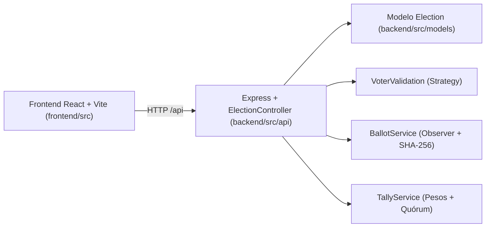

# Sistema de votação eletrônica auditável (MC656)

Projeto desenvolvido para a disciplina MC656 (Engenharia de Software, IC/UNICAMP, 2s2026).

## Integrantes do grupo

- Giovanni Santos Scalabrin (RA 281210): `gsscala`
- Rodrigo Banin Ferraz de Camargo (RA 238257): `rbfcdog`
- Lucca Maso Miranda (RA 281827): `LuccaMaso`
- Leandro Marcos Checchio de Souza (RA 244784): `leanchec`

## Problema abordado e cenários de uso

Processos eleitorais em instituições distintas variam nas regras de elegibilidade, no peso de cada voto e nas exigências de quórum. O sistema centraliza o ciclo de vida de uma eleição (criação, votação, auditoria por recibos e apuração) e isola as regras específicas de cada cenário:

1. **Centro Acadêmico (`centro-academico`)**: eleição com lista fechada de chapas, validação de RA discente numérico de 6 dígitos (`AcademicCenterValidationStrategy`) e contagem de votos.
2. **Assembleia de Condomínio (`assembleia-condominio`)**: votação com validação de CPF de 11 dígitos (`CondoAssemblyValidationStrategy`), suporte a pesos fracionários proporcionais à fração ideal do imóvel e verificação de quórum mínimo.
3. **Orçamento Participativo Municipal (`orcamento-municipal`)**: votação aberta para projetos públicos com validação de credencial cidadã não vazia (`MunicipalBudgetValidationStrategy`) e seleção entre múltiplas propostas.

## Arquitetura e decisões de projeto

O sistema divide o código em camadas independentes no backend e uma interface web em React no frontend:



### Padrões de projeto aplicados

- **Strategy (`backend/src/services/voterValidation.ts`)**: a interface `ValidationStrategy` define o contrato `validate(voter, context)` e é implementada por `AcademicCenterValidationStrategy`, `CondoAssemblyValidationStrategy` e `MunicipalBudgetValidationStrategy`. O mapa `validationStrategies` associa cada `ElectionType` à sua estratégia sem condicionais acopladas ao fluxo principal.
- **Observer (`backend/src/services/ballotService.ts`)**: `BallotService` mantém uma lista de `BallotObserver` notificados a cada voto válido registrado. O controlador anexa dois observadores concretos: `AuditLogObserver`, que registra os recibos emitidos sem guardar a opção escolhida (`optionId`), e `TurnoutCounterObserver`, que mantém a contagem de comparecimento por eleição.
- **Imutabilidade e tolerância numérica**: `Election` (`backend/src/models/election.ts`) congela a lista de opções com `Object.freeze` e controla a janela temporal pelos estados `scheduled`, `open` e `closed`. Na apuração (`backend/src/services/tallyService.ts`), `determineWinners` usa `EPSILON = 1e-9` para evitar falhas de arredondamento em ponto flutuante ao comparar somas de pesos fracionários.

### Evolução de escopo em relação ao planejamento inicial

Em relação à especificação da Atividade 1:

- **Persistência em memória**: optamos por manter eleições, votos e recibos em memória no controlador e nos serviços de domínio em vez de configurar um banco de dados externo, priorizando o isolamento das regras de negócio e a cobertura de testes determinísticos.
- **Autenticação por estratégia de credencial**: a verificação de eleitores usa validação de formato de credencial e checagem de status (`active` ou `blocked`) em `VoterValidationService`, sem integração com provedor OAuth externo.
- **Fluxo unificado de votação**: no cenário de orçamento municipal, as propostas já chegam cadastradas como opções da eleição (`ElectionOption[]`), unificando a submissão de cédulas e a auditoria entre os três tipos de pleito.

## Organização do repositório

```text
mc656/
├── .github/workflows/ci.yml              # Pipeline de CI no GitHub Actions
├── README.md                             # Documentação principal do projeto
├── backend/
│   ├── cucumber.js                       # Configuração do executor BDD (Cucumber)
│   ├── eslint.config.mjs                 # Regras ESLint para TypeScript
│   ├── jest.config.js                    # Configuração do Jest + ts-jest
│   ├── package.json                      # Dependências e scripts do backend
│   ├── stryker.config.json               # Configuração do teste de mutação (Stryker)
│   ├── tsconfig.json                     # Compilador TypeScript com checagem estrita
│   ├── features/
│   │   ├── votacao_auditoria.feature     # Cenários Gherkin em português (BDD)
│   │   └── step_definitions/
│   │       └── votacao.steps.ts          # Passos executáveis via Supertest
│   └── src/
│       ├── index.ts                      # Ponto de entrada HTTP (porta 3001 + seed)
│       ├── api/
│       │   ├── app.ts                    # Fábrica Express com CORS e JSON parser
│       │   ├── electionController.ts     # Controlador REST e integração dos serviços
│       │   ├── electionController.test.ts# Testes estruturais do controlador (Supertest)
│       │   ├── electionRoutes.ts         # Mapeamento das rotas /api
│       │   └── seed.ts                   # Carga inicial dos 3 cenários de demonstração
│       ├── models/
│       │   ├── election.ts               # Entidade Election e máquina de estados temporal
│       │   └── election.test.ts          # Testes unitários do modelo
│       └── services/
│           ├── ballotService.ts          # Registro de cédula, recibo SHA-256 e Observers
│           ├── ballotService.test.ts     # Testes unitários e dos observadores
│           ├── ballotService.functional.test.ts   # AVL temporal e classes de equivalência
│           ├── tallyService.ts           # Apuração ponderada, quórum e desempate
│           ├── tallyService.test.ts      # Testes unitários e eliminação de mutante
│           ├── tallyService.functional.test.ts    # Classes de equivalência de apuração
│           ├── voterValidation.ts        # Estratégias de elegibilidade de eleitores
│           ├── voterValidation.test.ts   # Testes unitários das estratégias
│           └── voterValidation.functional.test.ts # Classes de equivalência de credenciais
└── frontend/
    ├── eslint.config.js                  # ESLint com regras React Hooks
    ├── index.html                        # HTML raiz da aplicação Vite
    ├── jest.config.cjs                   # Jest com jsdom e ts-jest para componentes React
    ├── package.json                      # Dependências e scripts do frontend
    ├── tsconfig.app.json                 # Configuração TypeScript da aplicação
    ├── vite.config.ts                    # Proxy /api -> http://localhost:3001
    └── src/
        ├── App.tsx                       # Interface de votação, apuração e auditoria
        ├── App.css                       # Estilos da interface
        ├── App.test.tsx                  # Testes de componente (React Testing Library)
        ├── api.ts                        # Cliente HTTP tipado para a API REST
        └── main.tsx                      # Ponto de montagem React
```

## Pré-requisitos e execução local

O projeto requer **Node.js 22** (`22.22.1` especificado em `backend/package.json`) e `npm`. Não é necessário configurar arquivo `.env` nem banco de dados externo: o backend inicializa na porta `3001` (configurável pela variável de ambiente `PORT`) e carrega automaticamente três eleições de exemplo (`ca-computacao-2026`, `condominio-solar-2026` e `orcamento-campinas-2026`).

### 1. Instalar dependências e iniciar o backend

Em um primeiro terminal:

```bash
cd backend
npm ci
npm run dev
```

Para executar a versão compilada em produção:

```bash
cd backend
npm run build
npm start
```

### 2. Instalar dependências e iniciar o frontend

Em um segundo terminal:

```bash
cd frontend
npm ci
npm run dev
```

Acesse a aplicação no navegador em `http://localhost:5173`. O servidor Vite encaminha automaticamente as requisições `/api/*` para `http://localhost:3001`.

## Endpoints da API REST

| Método | Rota | Descrição |
| :--- | :--- | :--- |
| `GET` | `/api/elections` | Lista todas as eleições cadastradas com status e comparecimento |
| `POST` | `/api/elections` | Cadastra uma nova eleição |
| `GET` | `/api/elections/:id` | Consulta detalhes de uma eleição específica |
| `POST` | `/api/elections/:id/votes` | Valida elegibilidade, registra voto e devolve recibo SHA-256 |
| `GET` | `/api/elections/:id/tally` | Calcula apuração ponderada (aceita `?force=true` com eleição aberta) |
| `GET` | `/api/elections/:id/receipts/:hash` | Verifica a autenticidade de um recibo emitido |
| `GET` | `/api/elections/:id/audit` | Retorna o contador do `TurnoutCounterObserver` e os logs do `AuditLogObserver` |

Exemplo de requisição direta com `curl`:

```bash
# Listar eleições pré-carregadas
curl http://localhost:3001/api/elections

# Registrar um voto no cenário de Centro Acadêmico
curl -X POST http://localhost:3001/api/elections/ca-computacao-2026/votes \
  -H "Content-Type: application/json" \
  -d '{"voterId":"aluno-99","credentials":"281210","voterStatus":"active","optionId":"chapa-integracao","weight":1}'

# Consultar apuração parcial da Assembleia de Condomínio
curl "http://localhost:3001/api/elections/condominio-solar-2026/tally?force=true"
```

## Qualidade, testes e integração contínua

### Backend

```bash
cd backend
npm run lint       # Verificação estática com ESLint
npm run build      # Compilação TypeScript estrita (strict, noUncheckedIndexedAccess, exactOptionalPropertyTypes)
npm test           # Suítes unitárias, funcionais (CE e AVL) e estruturais com cobertura Istanbul
npm run test:bdd   # Cenários de aceitação Gherkin executados com Cucumber + Supertest
npx stryker run    # Teste de mutação nos serviços de domínio (src/services)
```

Na entrega da Atividade 5 (tag `a5-v1.0.0`), a execução do Stryker sobre os três serviços de domínio gerou 348 mutantes e atingiu índice global de mutação de 92,24% após a inclusão do teste discriminador no limiar `EPSILON = 1e-9` de `tallyService.ts`.

### Frontend

```bash
cd frontend
npm run lint       # ESLint com regras de hooks do React 19
npm run build      # Checagem TypeScript (tsc -b) e empacotamento Vite
npm test           # Testes de interface com Jest, jsdom e React Testing Library
```

### Pipeline de CI e fluxo de entrega

O arquivo `.github/workflows/ci.yml` executa automaticamente em cada `push` e `pull_request` para as branches `develop` e `main` as etapas de instalação (`npm ci`), lint, compilação, testes unitários/funcionais/estruturais com cobertura e cenários BDD para o backend, além de lint, build e testes para o frontend. O desenvolvimento segue GitFlow (`feature/*` e `test/*` integradas em `develop` via Pull Request, consolidadas em `main` e versionadas por tags de release).
